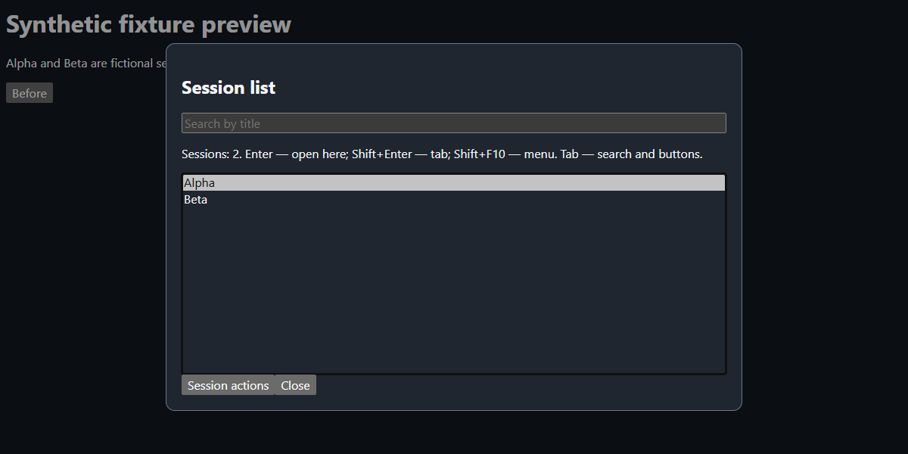

# Accessible Session List for Hermes Desktop

A native, keyboard-focused session picker with title search and explicit navigation actions. Version 1.0.0, MIT licensed. Requires Hermes **0.22.5 or later** and its public Desktop plugin SDK. The original navigation behavior was user-tested on Hermes 0.22.5; the public package's localization and packaging are covered by synthetic automated tests, not a new live-app acceptance run.

## Preview



**Synthetic fixture preview, not a live Hermes screenshot.** Only fictional Alpha/Beta sessions are used. Reproduce with `npm run screenshot` after setting up a browser below. The harness supplies demonstration theme variables; actual colors follow Hermes's active theme.

## Install

In Hermes Desktop, open **Capabilities → Plugins → Install from Git** and enter:

```text
https://github.com/denis-skripnik/hermes-accessible-session-list
```

Select the Desktop component and enable it after installation. This repository supplies `plugin.yaml` plus `desktop/plugin.js`; it has no Python backend. Package desktop discovery and enable controls require a compatible Hermes Desktop build. As a standalone alternative, copy **only** `desktop/plugin.js` into `$HERMES_HOME/desktop-plugins/accessible-session-list/plugin.js`. Keep that directory name equal to the exported id. Do not install both forms simultaneously. No npm dependencies are needed to run the plugin.

Disable the plugin through Desktop's Plugins settings to remove its listener and close its dialog. No stored sessions are changed.

## Controls

| Control | Action |
| --- | --- |
| Command palette: **Session list** | Open picker without relying on Ctrl+H |
| Ctrl+H | Open picker, **unless Hermes core handles it first** |
| Up/Down, Home/End, Page Up/Page Down | Native list selection without navigation |
| Enter or double click | Open using SDK `in-place` intent |
| Shift+Enter | Open using SDK `tab` intent |
| Shift+F10, context-menu key, right click, or Session actions | Open actions menu |
| Menu arrows, Home/End | Move between actions |
| Escape | Dismiss menu first, then picker; restore prior connected focus |
| Shift+Tab from list | Reach search |
| Down from search | Focus list |

English is the fallback UI language. Russian is selected through the public `ctx.i18n` API when Hermes uses Russian. Dialog strings are resolved when the picker opens; reopen after a locale switch. The palette label is resolved when the plugin registers, so re-enable the plugin to refresh that label after changing language. Native HTML `dialog`, `select`, and `option` elements expose standard accessibility semantics. Screen-reader announcements still need user acceptance testing on each platform.

## Scope and navigation contract

- Reads the active gateway profile at opening and uses that same profile for navigation.
- Requests at most **500** persisted sessions with `host.listPersistedSessions(null, { profile, limit: 500 })`. Membership is capped by the endpoint's **creation-ordered fetched set**; it is not every session and not necessarily the globally most recently active 500. Search only filters this fetched set.
- Excludes hidden, archived, internal-child, `tool`, `subagent`, and `cron` rows, plus untitled zero-message drafts. Invalid ids are excluded and duplicate ids are collapsed. Ordinary `local-` chats and genuine branches remain eligible; filtering never relies on title language.
- Sorts retained rows descending by **`last_active || started_at || 0`**, matching activity recency rather than passive tab visits. This client-side sort cannot recover active sessions outside the fetched membership.
- `in-place` focuses an existing session tab or routes into the SDK's primary conversation area. It **does not guarantee replacement of an arbitrary currently focused secondary tab**.
- `tab` opens a tab or focuses an existing one; it avoids duplicate tabs for an already-open session. The plugin forwards intents; Hermes implements these semantics.

## Shortcut conflict and security

The tested window capture listener is retained. Hermes core can have an earlier Ctrl+H handler; **this plugin cannot bypass that conflict**. Use the palette command instead. It never patches event prototypes, rewrites shortcut storage keys, or replaces core handlers.

The runtime imports only `@hermes/plugin-sdk`. Its dialog and menu DOM belong to the plugin; it does not query or alter core application markup, internal stores, or raw bridges. It runs only in the main/session window, not HUD or other auxiliary windows. Desktop plugins run with renderer authority, so review source before enabling them: the SDK boundary is an implementation discipline, not a sandbox.

There are no tools, hooks, middleware, required environment variables, backend, credentials, telemetry, self-updater, shell commands, or runtime filesystem reads. The only runtime data access is the public Hermes session-list/navigation API, which may communicate with your configured gateway. Session titles are displayed transiently in memory; the plugin does not persist or export them, contact third-party services, or modify history. Dependencies below are development-only and npm/browser setup downloads from their upstream distribution services.

## Development and verification

Use Node.js 26 or later and npm. Dependencies are exact-pinned and locked, local to this repository; do not copy a developer's shared `node_modules`.

```sh
npm ci --ignore-scripts
npm test
```

Optional real Chromium checks use a Playwright-managed browser by default:

```sh
npx playwright install chromium
npm run test:browser
npm run screenshot
```

To use an **already installed Microsoft Edge** instead of downloading Chromium, set `PLAYWRIGHT_CHANNEL=msedge` before either browser script (POSIX example: `PLAYWRIGHT_CHANNEL=msedge npm run test:browser`; PowerShell: `$env:PLAYWRIGHT_CHANNEL='msedge'`). The tests do not launch or restart Hermes or install this plugin.

The Node/jsdom suite covers source filtering, activity sorting, search, intent dispatch, menu keyboard navigation, focus restoration, English fallback and Russian labels. The browser harness checks real native ArrowDown selection without navigation, Enter, Shift+Enter, menu dispatch and Escape. Test-only SDK doubles provide fictional data; they do not validate gateway integration or real screen-reader speech. Dynamic source compilation is confined to test harnesses; `desktop/plugin.js` contains no `eval` or `new Function`.

## Author and license

[Denis Skripnik](https://blinddev.xyz) · [GitHub](https://github.com/denis-skripnik) · [MIT](LICENSE).
